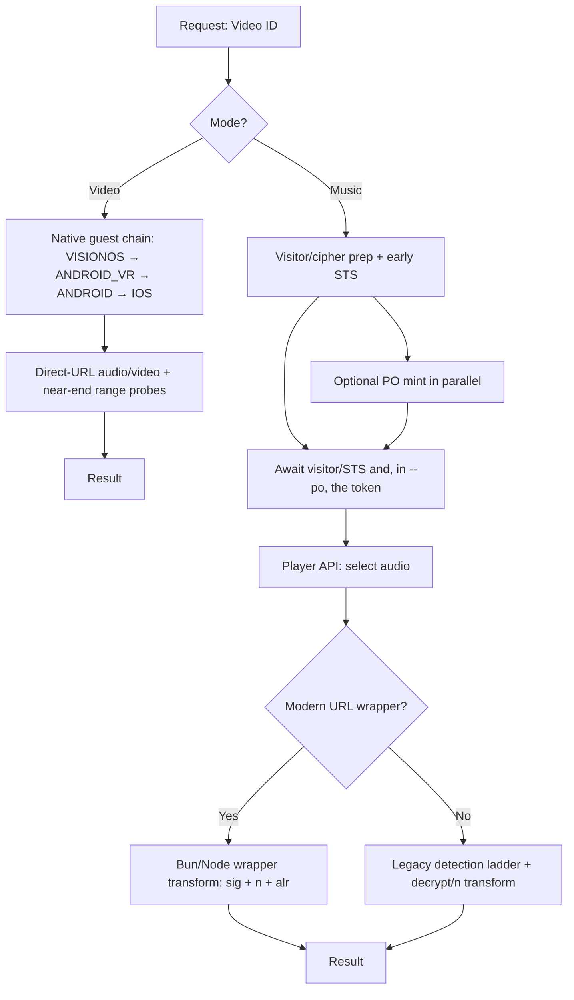

# Architecture Overview

`ytx` is built for low-latency extraction, with separate paths for video and music because the two modes need different YouTube clients and validation.

## The dual-client strategy

| Client mode | Client path | What it does |
| :--- | :--- | :--- |
| **Video** | Sequential native chain: `VISIONOS` → `ANDROID_VR` → `ANDROID` → `IOS` | Guest-only, direct-URL formats, no cipher/PO/JS. Each candidate is checked with near-end byte-range probes. |
| **Music** | `WEB_REMIX` | Authenticated audio path; uses cipher/signature/n handling and, on modern players, the URL-wrapper protocol. |

Video mode's probes prove that the returned direct range is readable; they are not proof that a signature/n decode is correct. The native chain deliberately does not run cipher or PO work.

Music mode's modern URL-wrapper path requires Bun or Node and produces signature, n, and `alr` in one subprocess transform. QuickJS is legacy-only: legacy signature decryption always uses it, and legacy `auto` may use it for the n-transform. It cannot run modern wrappers.

Authentication is intentionally separated: the native video path is guest-only, while cookies/SAPISIDHASH belong to the music path. See `docs/architecture/extraction-pipeline.md` for the call chain.

## Design principles

1. **Native Go orchestration**: HTTP, cache, and extraction control live in Go.
2. **FCIS detection ladder**: bounded windowed markers first, broader wrapper/global scans only when needed. A recognized modern wrapper takes precedence and ambiguous wrapper candidates fail closed.
3. **Connection reuse**: HTTP clients are shared and pooled for API and player fetches.
4. **Identity-checked cache**: when a cached player bundle is present, it is reused only when the full-content fingerprint (and, when available, the STS) agrees.
5. **Explicit PO lane**: `--po` mints a token in a short-lived Bun/Node subprocess. It is not a daemon and not a universal 403 fix.
6. **Explicit failure over silent fallback**: modern wrapper failures return errors; they do not silently fall back to QuickJS or an untransformed URL.

## High-level flow

## Performance

There are no current fixed latency promises. Historical measurements and their dates are retained in `docs/architecture/extraction-pipeline.md`; they describe older paths and environments and should not be presented as current benchmarks. Use `docs/guides/benchmarking.md` to measure a specific build and cache state.
